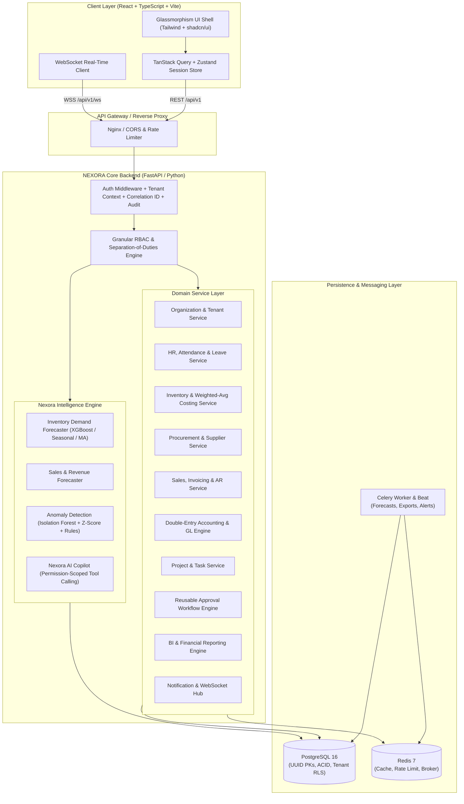
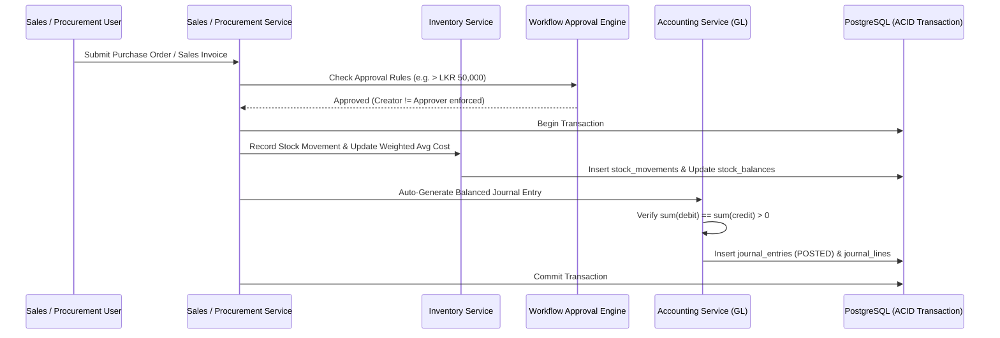

# NEXORA ERP — System Architecture & Engineering Blueprint

## 1. Architectural Overview

**NEXORA ERP** is built as a **production-grade modular monolith** with a decoupled single-page frontend, a domain-driven FastAPI backend, an asynchronous Celery/Redis task pipeline, an embedded Machine Learning & AI Copilot engine, and a multi-tenant PostgreSQL relational database.

### High-Level System Architecture



---

## 2. Multi-Tenant Data Isolation Architecture

Every business record in NEXORA ERP belongs to a specific `organization_id` (and optionally a `branch_id` and `department_id`).

1. **Tenant Context Injection**:
   - Authenticated requests validate the user's JWT access token and active `X-Organization-ID` header (or default organization from user membership).
   - The backend verifies that the user is an active member of that `organization_id`.
2. **Application-Level & Database-Level Isolation**:
   - Every repository/service query explicitly filters by `organization_id == current_tenant.id`.
   - PostgreSQL session variables (`SET LOCAL app.current_organization_id = '<uuid>'`) support Row-Level Security (RLS) policies on tenant-owned tables.
   - Cross-tenant references (e.g., linking an invoice from Organization A to a customer in Organization B) are rejected at both service validation and composite foreign-key validation layers.

---

## 3. Double-Entry Accounting & Operational Integration Flow

All financial KPIs on the Executive Dashboard and Financial Reports derive directly from balanced `journal_entries` and `journal_lines`.



---

## 4. Reusable Workflow & Approval Engine

Instead of hardcoding approval statuses in individual modules, NEXORA ERP routes all gated documents (`purchase_request`, `purchase_order`, `leave_request`, `expense`, `stock_adjustment`) through the central **Workflow Engine**:

- **`approval_workflows`**: Defines rules per organization and document type (e.g., `purchase_order`).
- **`approval_steps`**: Defines step sequence, threshold condition (`min_amount`, `max_amount`), required `role_code` or `permission_code`, and approval mode (`SEQUENTIAL` or `PARALLEL`).
- **`approval_requests`**: Tracks the active state of a document's approval lifecycle.
- **`approval_actions`**: Immutable audit record of each step approval, rejection (with mandatory reason), or escalation.
- **Separation of Duties Rule**: `requester_user_id != approver_user_id` is strictly enforced for restricted financial and procurement approvals.

---

## 5. Repository Folder Structure

```text
NEXORA-AI/
├── backend/
│   ├── alembic/                    # Database migrations
│   ├── app/
│   │   ├── api/
│   │   │   ├── deps.py             # Auth, RBAC, Tenant & DB dependencies
│   │   │   └── v1/                 # Versioned domain routers
│   │   │       ├── auth.py
│   │   │       ├── organizations.py
│   │   │       ├── users.py
│   │   │       ├── hr.py
│   │   │       ├── inventory.py
│   │   │       ├── procurement.py
│   │   │       ├── sales.py
│   │   │       ├── finance.py
│   │   │       ├── projects.py
│   │   │       ├── workflows.py
│   │   │       ├── analytics.py
│   │   │       ├── ai.py
│   │   │       └── notifications.py
│   │   ├── core/
│   │   │   ├── config.py           # Environment settings
│   │   │   ├── database.py         # SQLAlchemy 2.x engine & session
│   │   │   ├── security.py         # Argon2id, JWT, TOTP MFA, CSRF
│   │   │   ├── exceptions.py       # Standardized error handlers
│   │   │   └── logging.py          # Correlation IDs & structured logs
│   │   ├── models/                 # Normalized SQLAlchemy 2.x ORM models
│   │   ├── schemas/                # Pydantic v2 request/response schemas
│   │   ├── services/               # Business logic & accounting/AI engines
│   │   │   ├── accounting_service.py
│   │   │   ├── inventory_service.py
│   │   │   ├── workflow_service.py
│   │   │   ├── ai_forecasting.py
│   │   │   ├── ai_anomaly.py
│   │   │   ├── ai_copilot.py
│   │   │   └── seed_service.py     # "Nexora Demo Holdings" generator
│   │   ├── worker/                 # Celery background tasks
│   │   └── main.py                 # FastAPI entrypoint
│   ├── tests/                      # Pytest unit, integration & security tests
│   ├── Dockerfile
│   └── requirements.txt
├── frontend/
│   ├── src/
│   │   ├── api/                    # Axios/Fetch client + TanStack Query hooks
│   │   ├── components/
│   │   │   ├── layout/             # GlassSidebar, TopNavbar, CommandPalette
│   │   │   ├── ui/                 # Reusable Glass cards, DataTables, Modals
│   │   │   └── charts/             # Recharts glass-styled financial charts
│   │   ├── context/                # AuthContext, ThemeContext, TenantContext
│   │   ├── pages/                  # All 12 domain module views
│   │   ├── types/                  # TypeScript interfaces matching API
│   │   ├── utils/                  # LKR currency, DD MMM YYYY date formatters
│   │   ├── App.tsx
│   │   └── main.tsx
│   ├── Dockerfile
│   ├── package.json
│   └── vite.config.ts
├── docs/
│   ├── ARCHITECTURE.md
│   ├── DATABASE_SCHEMA.md
│   ├── API_CONTRACTS.md
│   ├── DESIGN_SYSTEM.md
│   ├── PERMISSION_MATRIX.md
│   ├── AI_MODELS.md
│   ├── SECURITY.md
│   └── ADR/
├── .github/workflows/ci.yml
├── docker-compose.yml
├── .env.example
├── DEVELOPMENT_PROGRESS.md
└── README.md
```
