# NEXORA ERP — Normalized Relational Database Schema

## 1. Database Design Principles

- **Primary Database**: PostgreSQL 16 (configured via `DATABASE_URL`, with SQLAlchemy 2.x async/sync ORM and Alembic migrations; supports SQLite-compatible execution mode ONLY for automated CI/local fallback when a PostgreSQL server container is not running on the host, while preserving full PostgreSQL DDL, UUIDs, Numeric(18,2), Foreign Keys, Unique Constraints, and Indexes).
- **Primary Keys**: UUID v4 across all entities.
- **Tenant Isolation**: Every tenant-owned business entity includes `organization_id UUID NOT NULL REFERENCES organizations(id)` and composite indexes `(organization_id, ...)`.
- **Financial Precision**: All monetary amounts and quantities use `NUMERIC(18, 4)` / `NUMERIC(18, 2)` (`Decimal` in Python) — never floating-point numbers.
- **Timestamps**: Stored consistently in UTC (`created_at`, `updated_at`), formatted in organization timezone (`Asia/Colombo` by default, `DD MMM YYYY`).
- **Double-Entry Enforcement**: `journal_entries` can only transition to `POSTED` when `SUM(debit) == SUM(credit) > 0`. Posted entries are immutable and require reversal entries for corrections.
- **Inventory Integrity**: `stock_balances.quantity_on_hand >= 0` enforced at service and transaction boundaries; every stock change creates an immutable `stock_movements` ledger row.

---

## 2. Entity-Relationship Diagram (Core Domains)

```mermaid
erDiagram
    ORGANIZATIONS ||--o{ BRANCHES : has
    ORGANIZATIONS ||--o{ DEPARTMENTS : has
    ORGANIZATIONS ||--o{ USERS : employs
    USERS }o--o{ ROLES : assigned_via_user_roles
    ROLES }o--o{ PERMISSIONS : grants_via_role_permissions

    ORGANIZATIONS ||--o{ EMPLOYEES : manages
    DEPARTMENTS ||--o{ EMPLOYEES : contains
    DESIGNATIONS ||--o{ EMPLOYEES : classifies
    EMPLOYEES ||--o{ ATTENDANCE_RECORDS : logs
    EMPLOYEES ||--o{ LEAVE_REQUESTS : submits
    EMPLOYEES ||--o{ LEAVE_BALANCES : holds
    EMPLOYEES ||--o{ PERFORMANCE_REVIEWS : receives

    ORGANIZATIONS ||--o{ PRODUCTS : catalogs
    PRODUCT_CATEGORIES ||--o{ PRODUCTS : groups
    ORGANIZATIONS ||--o{ WAREHOUSES : operates
    WAREHOUSES ||--o{ WAREHOUSE_LOCATIONS : divides_into
    PRODUCTS ||--o{ STOCK_BALANCES : stored_in
    WAREHOUSES ||--o{ STOCK_BALANCES : holds
    PRODUCTS ||--o{ STOCK_MOVEMENTS : tracks
    WAREHOUSES ||--o{ STOCK_TRANSFERS : originates

    ORGANIZATIONS ||--o{ SUPPLIERS : partners_with
    ORGANIZATIONS ||--o{ PURCHASE_REQUESTS : raises
    PURCHASE_REQUESTS ||--o{ PURCHASE_REQUEST_ITEMS : contains
    SUPPLIERS ||--o{ SUPPLIER_QUOTATIONS : submits
    SUPPLIERS ||--o{ PURCHASE_ORDERS : fulfills
    PURCHASE_ORDERS ||--o{ PURCHASE_ORDER_ITEMS : line_items
    PURCHASE_ORDERS ||--o{ GOODS_RECEIPTS : received_via
    GOODS_RECEIPTS ||--o{ GOODS_RECEIPT_ITEMS : items

    ORGANIZATIONS ||--o{ CUSTOMERS : serves
    CUSTOMERS ||--o{ SALES_QUOTATIONS : requests
    CUSTOMERS ||--o{ SALES_ORDERS : places
    SALES_ORDERS ||--o{ SALES_ORDER_ITEMS : contains
    CUSTOMERS ||--o{ INVOICES : billed_via
    INVOICES ||--o{ INVOICE_ITEMS : details
    INVOICES ||--o{ PAYMENTS : settled_by
    INVOICES ||--o{ SALES_RETURNS : returned_against

    ORGANIZATIONS ||--o{ ACCOUNTS : chart_of_accounts
    ORGANIZATIONS ||--o{ FINANCIAL_PERIODS : defines
    ORGANIZATIONS ||--o{ JOURNAL_ENTRIES : posts
    JOURNAL_ENTRIES ||--|{ JOURNAL_LINES : balances
    ACCOUNTS ||--o{ JOURNAL_LINES : ledger_postings
    ORGANIZATIONS ||--o{ EXPENSES : incurs
    ORGANIZATIONS ||--o{ BANK_ACCOUNTS : maintains

    ORGANIZATIONS ||--o{ PROJECTS : executes
    PROJECTS ||--o{ PROJECT_MEMBERS : staffs
    PROJECTS ||--o{ TASKS : breaks_down
    PROJECTS ||--o{ MILESTONES : tracks
    TASKS ||--o{ TASK_COMMENTS : discusses

    ORGANIZATIONS ||--o{ APPROVAL_WORKFLOWS : configures
    APPROVAL_WORKFLOWS ||--|{ APPROVAL_STEPS : sequences
    APPROVAL_WORKFLOWS ||--o{ APPROVAL_REQUESTS : instantiates
    APPROVAL_REQUESTS ||--o{ APPROVAL_ACTIONS : audits

    ORGANIZATIONS ||--o{ FORECAST_RUNS : runs_ml
    FORECAST_RUNS ||--o{ FORECAST_RESULTS : outputs
    ORGANIZATIONS ||--o{ ANOMALY_EVENTS : flags
    ORGANIZATIONS ||--o{ AI_CONVERSATIONS : hosts
    AI_CONVERSATIONS ||--o{ AI_MESSAGES : records
```

---

## 3. Complete Table Catalogue (56 Normalized Tables)

### A. Organization & Multi-Tenancy (3 Tables)
1. `organizations`: `id (UUID PK)`, `name`, `code (UNIQUE)`, `registration_number`, `tax_id`, `email`, `phone`, `address`, `logo_url`, `default_currency (default 'LKR')`, `timezone (default 'Asia/Colombo')`, `fiscal_year_start_month (default 4)`, `date_format (default 'DD MMM YYYY')`, `is_demo (BOOL)`, `is_active (BOOL)`, `created_at`, `updated_at`
2. `branches`: `id (UUID PK)`, `organization_id (FK)`, `name`, `code`, `city`, `address`, `phone`, `manager_name`, `is_headquarters (BOOL)`, `is_active (BOOL)`, `created_at`
3. `departments`: `id (UUID PK)`, `organization_id (FK)`, `branch_id (FK)`, `name`, `code`, `head_employee_id (UUID NULL)`, `budget_allocated (NUMERIC(18,2))`, `is_active (BOOL)`, `created_at`

### B. Authentication & Granular RBAC (7 Tables)
4. `users`: `id (UUID PK)`, `organization_id (FK)`, `branch_id (FK NULL)`, `department_id (FK NULL)`, `email (UNIQUE)`, `full_name`, `password_hash (Argon2id)`, `mfa_enabled (BOOL)`, `mfa_secret`, `failed_login_attempts (INT)`, `locked_until (TIMESTAMP NULL)`, `is_active (BOOL)`, `is_super_admin (BOOL)`, `theme_preference ('dark'|'light')`, `last_login_at`, `created_at`
5. `roles`: `id (UUID PK)`, `organization_id (FK NULL for system roles)`, `code`, `name`, `description`, `is_system (BOOL)`, `created_at`
6. `permissions`: `id (UUID PK)`, `code (UNIQUE)`, `module`, `description`
7. `user_roles`: `id (UUID PK)`, `user_id (FK)`, `role_id (FK)`, `assigned_at`
8. `role_permissions`: `id (UUID PK)`, `role_id (FK)`, `permission_id (FK)`
9. `refresh_tokens`: `id (UUID PK)`, `user_id (FK)`, `token_hash (UNIQUE)`, `family_id`, `expires_at`, `revoked_at (NULL)`, `ip_address`, `user_agent`, `created_at`
10. `login_attempts`: `id (UUID PK)`, `email`, `user_id (FK NULL)`, `ip_address`, `user_agent`, `succeeded (BOOL)`, `failure_reason`, `created_at`

### C. Human Resource Management (6 Tables)
11. `designations`: `id (UUID PK)`, `organization_id (FK)`, `title`, `grade`, `department_id (FK NULL)`
12. `employees`: `id (UUID PK)`, `organization_id (FK)`, `branch_id (FK)`, `department_id (FK)`, `designation_id (FK)`, `user_id (FK NULL)`, `employee_code (UNIQUE per org)`, `first_name`, `last_name`, `email`, `phone`, `national_id`, `employment_type ('FULL_TIME'|'CONTRACT'|'PROBATION')`, `employment_status ('ACTIVE'|'ON_LEAVE'|'TERMINATED')`, `join_date`, `base_salary (NUMERIC(18,2))`, `emergency_contact_name`, `emergency_contact_phone`, `created_at`
13. `attendance_records`: `id (UUID PK)`, `organization_id (FK)`, `employee_id (FK)`, `attendance_date (DATE)`, `check_in (TIMESTAMP)`, `check_out (TIMESTAMP)`, `status ('PRESENT'|'LATE'|'ABSENT'|'HALF_DAY'|'REMOTE')`, `hours_worked (NUMERIC(5,2))`, `notes`
14. `leave_requests`: `id (UUID PK)`, `organization_id (FK)`, `employee_id (FK)`, `leave_type ('ANNUAL'|'CASUAL'|'MEDICAL'|'UNPAID')`, `start_date`, `end_date`, `days_count (NUMERIC(4,1))`, `reason`, `status ('PENDING'|'APPROVED'|'REJECTED')`, `approved_by_id (FK NULL)`, `rejection_reason`, `created_at`
15. `leave_balances`: `id (UUID PK)`, `organization_id (FK)`, `employee_id (FK)`, `year (INT)`, `leave_type`, `entitled_days`, `used_days`, `remaining_days`
16. `performance_reviews`: `id (UUID PK)`, `organization_id (FK)`, `employee_id (FK)`, `reviewer_id (FK)`, `review_period`, `kpi_score (NUMERIC(4,2))`, `competency_score (NUMERIC(4,2))`, `overall_rating ('OUTSTANDING'|'EXCEEDS'|'MEETS'|'NEEDS_IMPROVEMENT')`, `strengths`, `improvements`, `status`, `review_date`

### D. Inventory & Warehouse Management (8 Tables)
17. `product_categories`: `id (UUID PK)`, `organization_id (FK)`, `name`, `code`, `description`
18. `products`: `id (UUID PK)`, `organization_id (FK)`, `category_id (FK)`, `sku (UNIQUE per org)`, `barcode`, `qr_code`, `name`, `description`, `uom ('PCS'|'BOX'|'KG'|'LTR'|'UNIT')`, `cost_price (NUMERIC(18,2))`, `weighted_avg_cost (NUMERIC(18,2))`, `selling_price (NUMERIC(18,2))`, `reorder_level (NUMERIC(18,2))`, `reorder_quantity (NUMERIC(18,2))`, `lead_time_days (INT)`, `preferred_supplier_id (FK NULL)`, `track_batch (BOOL)`, `track_expiry (BOOL)`, `is_active (BOOL)`, `created_at`
19. `warehouses`: `id (UUID PK)`, `organization_id (FK)`, `branch_id (FK)`, `name`, `code`, `address`, `manager_name`, `capacity_units (INT)`, `is_active (BOOL)`
20. `warehouse_locations`: `id (UUID PK)`, `organization_id (FK)`, `warehouse_id (FK)`, `zone`, `aisle`, `rack`, `bin_code`
21. `stock_balances`: `id (UUID PK)`, `organization_id (FK)`, `product_id (FK)`, `warehouse_id (FK)`, `location_id (FK NULL)`, `batch_number`, `expiry_date (DATE NULL)`, `quantity_on_hand (NUMERIC(18,2))`, `quantity_reserved (NUMERIC(18,2))`, `quantity_available (NUMERIC(18,2))`, `unit_cost (NUMERIC(18,2))`, `total_valuation (NUMERIC(18,2))`, `updated_at`
22. `stock_movements`: `id (UUID PK)`, `organization_id (FK)`, `product_id (FK)`, `warehouse_id (FK)`, `movement_type ('RECEIPT'|'ISSUE'|'ADJUSTMENT_IN'|'ADJUSTMENT_OUT'|'TRANSFER_IN'|'TRANSFER_OUT'|'RETURN')`, `reference_type`, `reference_id`, `reference_number`, `quantity (NUMERIC(18,2))`, `balance_after (NUMERIC(18,2))`, `unit_cost (NUMERIC(18,2))`, `performed_by_id (FK)`, `notes`, `created_at`
23. `stock_transfers`: `id (UUID PK)`, `organization_id (FK)`, `transfer_number (UNIQUE per org)`, `from_warehouse_id (FK)`, `to_warehouse_id (FK)`, `status ('DRAFT'|'IN_TRANSIT'|'COMPLETED'|'CANCELLED')`, `initiated_by_id (FK)`, `completed_by_id (FK NULL)`, `notes`, `created_at`
24. `stock_transfer_items`: `id (UUID PK)`, `transfer_id (FK)`, `product_id (FK)`, `requested_qty (NUMERIC(18,2))`, `transferred_qty (NUMERIC(18,2))`, `unit_cost (NUMERIC(18,2))`

### E. Procurement Management (8 Tables)
25. `suppliers`: `id (UUID PK)`, `organization_id (FK)`, `supplier_code (UNIQUE per org)`, `name`, `contact_person`, `email`, `phone`, `tax_id`, `address`, `payment_terms_days (INT)`, `rating (NUMERIC(3,2))`, `on_time_delivery_rate (NUMERIC(5,2))`, `is_active (BOOL)`, `created_at`
26. `purchase_requests`: `id (UUID PK)`, `organization_id (FK)`, `branch_id (FK NULL)`, `department_id (FK NULL)`, `pr_number (UNIQUE per org)`, `requested_by_id (FK)`, `required_date`, `estimated_total (NUMERIC(18,2))`, `status ('DRAFT'|'PENDING_APPROVAL'|'APPROVED'|'REJECTED'|'CONVERTED_TO_PO')`, `justification`, `approved_by_id (FK NULL)`, `rejection_reason`, `created_at`
27. `purchase_request_items`: `id (UUID PK)`, `purchase_request_id (FK)`, `product_id (FK)`, `quantity (NUMERIC(18,2))`, `estimated_unit_price (NUMERIC(18,2))`, `line_total (NUMERIC(18,2))`
28. `supplier_quotations`: `id (UUID PK)`, `organization_id (FK)`, `purchase_request_id (FK)`, `supplier_id (FK)`, `quotation_number`, `quoted_total (NUMERIC(18,2))`, `lead_time_days (INT)`, `validity_date`, `is_selected (BOOL)`, `notes`, `created_at`
29. `purchase_orders`: `id (UUID PK)`, `organization_id (FK)`, `po_number (UNIQUE per org)`, `supplier_id (FK)`, `purchase_request_id (FK NULL)`, `warehouse_id (FK)`, `order_date`, `expected_delivery_date`, `subtotal (NUMERIC(18,2))`, `tax_amount (NUMERIC(18,2))`, `total_amount (NUMERIC(18,2))`, `status ('DRAFT'|'PENDING_APPROVAL'|'APPROVED'|'PARTIALLY_RECEIVED'|'RECEIVED'|'REJECTED'|'CANCELLED')`, `created_by_id (FK)`, `approved_by_id (FK NULL)`, `rejection_reason`, `created_at`
30. `purchase_order_items`: `id (UUID PK)`, `purchase_order_id (FK)`, `product_id (FK)`, `ordered_qty (NUMERIC(18,2))`, `received_qty (NUMERIC(18,2))`, `unit_price (NUMERIC(18,2))`, `tax_rate (NUMERIC(5,2))`, `line_total (NUMERIC(18,2))`
31. `goods_receipts`: `id (UUID PK)`, `organization_id (FK)`, `grn_number (UNIQUE per org)`, `purchase_order_id (FK)`, `supplier_id (FK)`, `warehouse_id (FK)`, `received_date`, `received_by_id (FK)`, `supplier_invoice_no`, `total_received_value (NUMERIC(18,2))`, `status ('POSTED')`, `notes`, `created_at`
32. `goods_receipt_items`: `id (UUID PK)`, `goods_receipt_id (FK)`, `purchase_order_item_id (FK NULL)`, `product_id (FK)`, `received_qty (NUMERIC(18,2))`, `rejected_qty (NUMERIC(18,2))`, `unit_cost (NUMERIC(18,2))`, `line_total (NUMERIC(18,2))`

### F. Sales & Customer Management (8 Tables)
33. `customers`: `id (UUID PK)`, `organization_id (FK)`, `customer_code (UNIQUE per org)`, `name`, `customer_type ('CORPORATE'|'RETAIL'|'DISTRIBUTOR')`, `contact_person`, `email`, `phone`, `tax_id`, `billing_address`, `shipping_address`, `credit_limit (NUMERIC(18,2))`, `outstanding_balance (NUMERIC(18,2))`, `payment_terms_days (INT)`, `is_active (BOOL)`, `created_at`
34. `sales_quotations`: `id (UUID PK)`, `organization_id (FK)`, `quotation_number (UNIQUE per org)`, `customer_id (FK)`, `valid_until`, `subtotal (NUMERIC(18,2))`, `discount_amount (NUMERIC(18,2))`, `tax_amount (NUMERIC(18,2))`, `total_amount (NUMERIC(18,2))`, `status ('DRAFT'|'SENT'|'ACCEPTED'|'EXPIRED')`, `created_by_id (FK)`, `created_at`
35. `sales_orders`: `id (UUID PK)`, `organization_id (FK)`, `so_number (UNIQUE per org)`, `customer_id (FK)`, `quotation_id (FK NULL)`, `warehouse_id (FK)`, `order_date`, `status ('DRAFT'|'CONFIRMED'|'INVOICED'|'DELIVERED'|'CANCELLED')`, `subtotal (NUMERIC(18,2))`, `discount_amount (NUMERIC(18,2))`, `tax_amount (NUMERIC(18,2))`, `total_amount (NUMERIC(18,2))`, `created_by_id (FK)`, `created_at`
36. `sales_order_items`: `id (UUID PK)`, `sales_order_id (FK)`, `product_id (FK)`, `quantity (NUMERIC(18,2))`, `unit_price (NUMERIC(18,2))`, `discount_amount (NUMERIC(18,2))`, `tax_amount (NUMERIC(18,2))`, `line_total (NUMERIC(18,2))`
37. `invoices`: `id (UUID PK)`, `organization_id (FK)`, `invoice_number (UNIQUE per org)`, `invoice_type ('CUSTOMER_INVOICE'|'SUPPLIER_BILL')`, `customer_id (FK NULL)`, `supplier_id (FK NULL)`, `sales_order_id (FK NULL)`, `purchase_order_id (FK NULL)`, `issue_date`, `due_date`, `subtotal (NUMERIC(18,2))`, `discount_amount (NUMERIC(18,2))`, `tax_amount (NUMERIC(18,2))`, `total_amount (NUMERIC(18,2))`, `amount_paid (NUMERIC(18,2))`, `balance_due (NUMERIC(18,2))`, `status ('DRAFT'|'ISSUED'|'PARTIALLY_PAID'|'PAID'|'OVERDUE'|'VOID')`, `journal_entry_id (FK NULL)`, `created_by_id (FK)`, `created_at`
38. `invoice_items`: `id (UUID PK)`, `invoice_id (FK)`, `product_id (FK NULL)`, `description`, `quantity (NUMERIC(18,2))`, `unit_price (NUMERIC(18,2))`, `discount_amount (NUMERIC(18,2))`, `tax_amount (NUMERIC(18,2))`, `line_total (NUMERIC(18,2))`
39. `payments`: `id (UUID PK)`, `organization_id (FK)`, `payment_number (UNIQUE per org)`, `payment_type ('CUSTOMER_RECEIPT'|'SUPPLIER_PAYMENT')`, `invoice_id (FK)`, `customer_id (FK NULL)`, `supplier_id (FK NULL)`, `bank_account_id (FK NULL)`, `payment_date`, `amount (NUMERIC(18,2))`, `payment_method ('BANK_TRANSFER'|'CASH'|'CHEQUE'|'CARD')`, `reference_no`, `idempotency_key (UNIQUE NULL)`, `journal_entry_id (FK NULL)`, `recorded_by_id (FK)`, `created_at`
40. `sales_returns`: `id (UUID PK)`, `organization_id (FK)`, `return_number (UNIQUE per org)`, `invoice_id (FK)`, `customer_id (FK)`, `product_id (FK)`, `warehouse_id (FK)`, `quantity (NUMERIC(18,2))`, `refund_amount (NUMERIC(18,2))`, `reason`, `status`, `created_at`

### G. Finance & Double-Entry Accounting (6 Tables)
41. `accounts`: `id (UUID PK)`, `organization_id (FK)`, `code (UNIQUE per org)`, `name`, `account_type ('ASSET'|'LIABILITY'|'EQUITY'|'REVENUE'|'EXPENSE')`, `account_subtype ('CASH_BANK'|'ACCOUNTS_RECEIVABLE'|'INVENTORY'|'FIXED_ASSET'|'ACCOUNTS_PAYABLE'|'TAX_PAYABLE'|'RETAINED_EARNINGS'|'SALES_REVENUE'|'COGS'|'OPERATING_EXPENSE')`, `parent_id (FK NULL)`, `normal_balance ('DEBIT'|'CREDIT')`, `current_balance (NUMERIC(18,2))`, `is_system (BOOL)`, `is_active (BOOL)`, `created_at`
42. `financial_periods`: `id (UUID PK)`, `organization_id (FK)`, `name`, `start_date`, `end_date`, `is_closed (BOOL)`, `closed_by_id (FK NULL)`
43. `journal_entries`: `id (UUID PK)`, `organization_id (FK)`, `entry_number (UNIQUE per org)`, `period_id (FK NULL)`, `entry_date`, `reference_type`, `reference_id`, `reference_number`, `description`, `status ('DRAFT'|'POSTED'|'REVERSED')`, `total_debit (NUMERIC(18,2))`, `total_credit (NUMERIC(18,2))`, `reversal_of_id (FK NULL)`, `created_by_id (FK)`, `posted_by_id (FK NULL)`, `posted_at`, `created_at`
44. `journal_lines`: `id (UUID PK)`, `journal_entry_id (FK)`, `organization_id (FK)`, `account_id (FK)`, `description`, `debit (NUMERIC(18,2))`, `credit (NUMERIC(18,2))`, `department_id (FK NULL)`, `branch_id (FK NULL)`
45. `expenses`: `id (UUID PK)`, `organization_id (FK)`, `expense_number (UNIQUE per org)`, `department_id (FK NULL)`, `branch_id (FK NULL)`, `expense_account_id (FK)`, `submitted_by_id (FK)`, `category`, `vendor_name`, `expense_date`, `amount (NUMERIC(18,2))`, `tax_amount (NUMERIC(18,2))`, `total_amount (NUMERIC(18,2))`, `status ('DRAFT'|'PENDING_APPROVAL'|'APPROVED'|'PAID'|'REJECTED')`, `approved_by_id (FK NULL)`, `journal_entry_id (FK NULL)`, `description`, `created_at`
46. `bank_accounts`: `id (UUID PK)`, `organization_id (FK)`, `gl_account_id (FK)`, `account_name`, `bank_name`, `account_number`, `branch_name`, `currency`, `current_balance (NUMERIC(18,2))`, `is_active (BOOL)`

### H. Projects & Task Management (5 Tables)
47. `projects`: `id (UUID PK)`, `organization_id (FK)`, `project_code (UNIQUE per org)`, `name`, `description`, `department_id (FK NULL)`, `manager_employee_id (FK NULL)`, `start_date`, `end_date`, `budget (NUMERIC(18,2))`, `spent_amount (NUMERIC(18,2))`, `progress_percent (INT)`, `status ('PLANNING'|'IN_PROGRESS'|'ON_HOLD'|'COMPLETED')`, `priority ('LOW'|'MEDIUM'|'HIGH'|'CRITICAL')`, `created_at`
48. `project_members`: `id (UUID PK)`, `project_id (FK)`, `employee_id (FK)`, `role_in_project`, `allocation_percent (INT)`
49. `milestones`: `id (UUID PK)`, `project_id (FK)`, `title`, `due_date`, `status ('PENDING'|'COMPLETED'|'OVERDUE')`
50. `tasks`: `id (UUID PK)`, `organization_id (FK)`, `project_id (FK)`, `milestone_id (FK NULL)`, `task_code`, `title`, `description`, `assignee_employee_id (FK NULL)`, `status ('BACKLOG'|'TODO'|'IN_PROGRESS'|'REVIEW'|'DONE')`, `priority ('LOW'|'MEDIUM'|'HIGH'|'URGENT')`, `start_date`, `due_date`, `estimated_hours (NUMERIC(6,2))`, `logged_hours (NUMERIC(6,2))`, `depends_on_task_id (FK NULL)`, `created_at`
51. `task_comments`: `id (UUID PK)`, `task_id (FK)`, `author_user_id (FK)`, `comment_text`, `created_at`

### I. Workflow & Approval Engine (4 Tables)
52. `approval_workflows`: `id (UUID PK)`, `organization_id (FK)`, `name`, `document_type ('PURCHASE_REQUEST'|'PURCHASE_ORDER'|'EXPENSE'|'LEAVE_REQUEST'|'STOCK_ADJUSTMENT')`, `is_active (BOOL)`, `created_at`
53. `approval_steps`: `id (UUID PK)`, `workflow_id (FK)`, `step_order (INT)`, `step_name`, `min_amount (NUMERIC(18,2))`, `max_amount (NUMERIC(18,2) NULL)`, `required_role_code`, `required_permission_code`, `approval_mode ('SEQUENTIAL'|'PARALLEL')`
54. `approval_requests`: `id (UUID PK)`, `organization_id (FK)`, `workflow_id (FK)`, `document_type`, `document_id (UUID)`, `document_number`, `amount (NUMERIC(18,2))`, `current_step_order (INT)`, `status ('PENDING'|'APPROVED'|'REJECTED'|'ESCALATED')`, `requested_by_id (FK)`, `created_at`, `updated_at`
55. `approval_actions`: `id (UUID PK)`, `approval_request_id (FK)`, `step_order (INT)`, `actor_user_id (FK)`, `action ('APPROVE'|'REJECT'|'DELEGATE'|'ESCALATE')`, `comments`, `acted_at`

### J. System & Nexora Intelligence Engine (11 Tables)
56. `notifications`: `id (UUID PK)`, `organization_id (FK)`, `user_id (FK)`, `title`, `message`, `category ('INVENTORY'|'APPROVAL'|'FINANCE'|'HR'|'PROJECT'|'AI_ALERT'|'SECURITY')`, `severity ('INFO'|'WARNING'|'CRITICAL')`, `action_url`, `is_read (BOOL)`, `created_at`
57. `audit_logs`: `id (UUID PK)`, `organization_id (FK)`, `actor_user_id (FK NULL)`, `actor_email`, `action`, `entity_type`, `entity_id`, `before_state (JSON)`, `after_state (JSON)`, `ip_address`, `correlation_id`, `created_at`
58. `document_attachments`: `id (UUID PK)`, `organization_id (FK)`, `entity_type`, `entity_id`, `file_name`, `content_type`, `file_size_bytes (INT)`, `storage_path`, `uploaded_by_id (FK)`, `created_at`
59. `activity_events`: `id (UUID PK)`, `organization_id (FK)`, `module`, `title`, `description`, `actor_name`, `created_at`
60. `model_versions`: `id (UUID PK)`, `organization_id (FK)`, `model_type ('DEMAND_FORECAST'|'SALES_FORECAST'|'ANOMALY_DETECTION')`, `algorithm ('XGBOOST'|'SEASONAL_NAIVE'|'MOVING_AVERAGE'|'ISOLATION_FOREST')`, `version_tag`, `mae (NUMERIC(12,4))`, `rmse (NUMERIC(12,4))`, `wape (NUMERIC(8,4))`, `training_samples (INT)`, `hyperparameters (JSON)`, `trained_at`
61. `forecast_runs`: `id (UUID PK)`, `organization_id (FK)`, `model_version_id (FK)`, `forecast_type ('INVENTORY_DEMAND'|'SALES_REVENUE')`, `horizon_days (INT)`, `mae (NUMERIC(12,4))`, `rmse (NUMERIC(12,4))`, `wape (NUMERIC(8,4))`, `status`, `executed_by_id (FK NULL)`, `created_at`
62. `forecast_results`: `id (UUID PK)`, `forecast_run_id (FK)`, `organization_id (FK)`, `product_id (FK NULL)`, `target_period`, `horizon_bucket ('7D'|'30D'|'90D'|'MONTHLY')`, `predicted_value (NUMERIC(18,2))`, `lower_bound (NUMERIC(18,2))`, `upper_bound (NUMERIC(18,2))`, `current_stock (NUMERIC(18,2) NULL)`, `stockout_risk ('LOW'|'MEDIUM'|'HIGH'|'CRITICAL' NULL)`, `suggested_reorder_qty (NUMERIC(18,2) NULL)`
63. `anomaly_events`: `id (UUID PK)`, `organization_id (FK)`, `domain ('INVENTORY'|'EXPENSE'|'PROCUREMENT'|'INVOICE'|'SALES')`, `entity_type`, `entity_id`, `reference_number`, `anomaly_score (NUMERIC(6,4))`, `severity ('LOW'|'MEDIUM'|'HIGH'|'CRITICAL')`, `detection_method ('ISOLATION_FOREST'|'Z_SCORE'|'RULE_ENGINE')`, `title`, `reason`, `recommended_action`, `status ('OPEN'|'UNDER_REVIEW'|'RESOLVED'|'DISMISSED')`, `reviewed_by_id (FK NULL)`, `detected_at`
64. `ai_insights`: `id (UUID PK)`, `organization_id (FK)`, `category`, `title`, `summary`, `impact_estimate`, `confidence_score (NUMERIC(4,2))`, `source_references (JSON)`, `created_at`
65. `ai_conversations`: `id (UUID PK)`, `organization_id (FK)`, `user_id (FK)`, `title`, `created_at`, `updated_at`
66. `ai_messages`: `id (UUID PK)`, `conversation_id (FK)`, `role ('user'|'assistant')`, `content`, `factual_data (JSON)`, `source_references (JSON)`, `model_provider`, `created_at`
